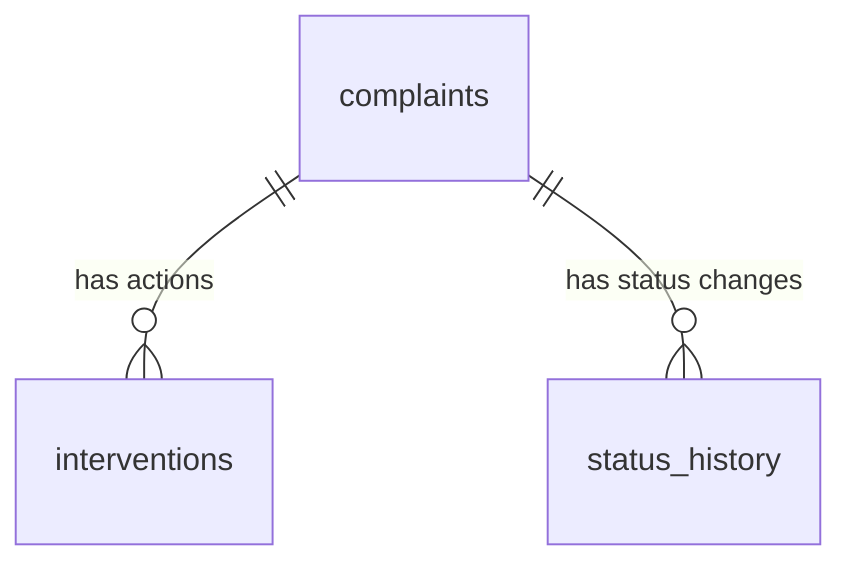

# EcoReport

Citizens of Mysuru report environmental problems (air and water pollution, illegal dumping, noise, deforestation), follow each complaint with a tracking ID, and see public statistics. Authorities manage complaints from an admin area.

Built with Next.js 16 (App Router), React 19, Tailwind CSS 4, Supabase (Postgres, Auth, Storage), Recharts and Leaflet.

## Features

- **Report** a problem in three short steps (the problem, place and time, your details) with inline checks, an optional photo and an optional map pin from the device's current location. The success screen shows a tracking ID with a copy button.
- **Track** a complaint by its ID: current status in plain words, a timeline of every status change (with the steps still to come), and the actions the authorities recorded.
- **Public dashboard**: totals, complaints by status and by type, a monthly trend, average time to resolve, the most reported places and a map.
- **Admin area**: complaint list with status and type filters and a quick search, and a detail page to change the status, record actions (interventions) and give a reason when a complaint is rejected.
- **Accessible design**: WCAG AA colour contrast, 44px touch targets, keyboard focus rings, a skip link, screen-reader labels, loading skeletons, friendly error states and reduced motion when the device asks for it.

## Pages

| Route | Who | What it does |
|---|---|---|
| `/` | everyone | Intro, the two main actions and live counters |
| `/report` | everyone | Three-step complaint form (optional photo and location pin). Shows the tracking ID on success |
| `/track?id=ECO-2026-0001` | everyone | Status, timeline and interventions for one complaint |
| `/dashboard` | everyone | Complaints by type and status, monthly trend, average time to resolve, top locations, map |
| `/admin/login` | admins | Email and password sign-in |
| `/admin` | admins | All complaints, filter by status and type, search |
| `/admin/ECO-2026-0001` | admins | Reporter details, status change, rejection reason, record interventions |

## How to use

### Citizen

1. Open the home page and choose **Report a problem**.
2. **Step 1, The problem:** pick the type (air, water, dumping, noise, deforestation, other) and describe what you see.
3. **Step 2, Place and time:** type the place (street, area or landmark). Optionally tap **Use my current location** to pin it on the map, pick the date you noticed it (not in the future; empty means today) and add a photo (JPG, PNG or WebP, up to 5 MB).
4. **Step 3, Your details:** enter your name and a phone number or email. Only the authorities see these. Check the summary and press **Send report**.
5. Save the **tracking ID** shown on screen (for example `ECO-2026-0022`) with **Copy tracking ID**.
6. Any time later, open **Track**, enter the ID and see the current status, the timeline and every action the authorities recorded.
7. The **Dashboard** shows the public numbers and the map for all complaints (without names or contacts).

### Admin (authorities)

1. Sign in at `/admin/login` with an admin account (see Setup, step 4).
2. The **Complaints** list shows the newest complaints first. Filter by status with the chips, by type with the drop-down, or search by tracking ID, place or reporter name.
3. Open a complaint to see its details, photo, map link and the reporter's private contact.
4. **Change status**: pick the new status and press **Save status**. Every change is written to the history automatically, and the citizen sees it on the track page.
   - When you pick **Rejected**, you must give a reason and the department. The reason is saved as an action ("Complaint rejected. Reason: ..."), so the citizen can see why.
5. **Record a new action**: what was done, the department, the date (not in the future; empty means today) and optional remarks. It appears on the citizen's track page straight away.
6. Use **Sign out** when you are done.

## How access works

- A public visitor cannot read or write any table directly. They only call three database functions: `submit_complaint`, `get_complaint_by_tracking_id` and `get_public_complaints`. None of them returns the reporter's name or contact.
- An admin is a signed-in user whose `app_metadata.role` is `admin`. Row Level Security lets only admins read all complaints, change status and add interventions.
- `src/proxy.ts` sends anyone who is not an admin away from `/admin/*`. Admin pages and Server Actions check the role again (`src/lib/auth.ts`), and the database enforces it a third time.
- Status changes are logged to `status_history` by a database trigger, which is what the timeline shows.

## Database schema

Everything (tables, triggers, Row Level Security, functions and the photo bucket) is in `supabase/migrations/20261120000000_init_ecoreport.sql`.



One complaint has many interventions and many status history rows. Both child tables point to `complaints.id` with `on delete cascade`, so deleting a complaint also deletes its actions and history.

### `complaints`

| Column | Type | Notes |
|---|---|---|
| `id` | uuid | Primary key |
| `tracking_id` | text, unique | Set by a trigger, e.g. `ECO-2026-0001` |
| `complaint_type` | enum `complaint_type_enum` | `air_pollution`, `water_pollution`, `illegal_dumping`, `noise`, `deforestation`, `other` |
| `description` | text | 10 to 2000 characters |
| `location_text` | text | 3 to 300 characters |
| `latitude`, `longitude` | double precision, optional | Valid ranges; both set or both empty |
| `complaint_date` | date | Defaults to today; `submit_complaint` rejects future dates |
| `status` | enum `complaint_status_enum` | `submitted` (default), `under_review`, `action_taken`, `resolved`, `rejected` |
| `reporter_name` | text | 2 to 100 characters, **private** (admins only) |
| `reporter_contact` | text | Phone or email, 3 to 100 characters, **private** |
| `photo_url` | text, optional | Must start with `http(s)://` |
| `created_at`, `updated_at` | timestamptz | `updated_at` is refreshed by a trigger |

### `interventions` (actions taken by the authorities)

| Column | Type | Notes |
|---|---|---|
| `id` | uuid | Primary key |
| `complaint_id` | uuid | Foreign key to `complaints.id` |
| `action_taken` | text | 3 to 1000 characters |
| `department` | text | 2 to 200 characters |
| `intervention_date` | date | Defaults to today; the admin action rejects future dates |
| `remarks` | text, optional | |
| `created_at` | timestamptz | |

### `status_history` (written only by a trigger)

| Column | Type | Notes |
|---|---|---|
| `id` | uuid | Primary key |
| `complaint_id` | uuid | Foreign key to `complaints.id` |
| `old_status` | status enum, optional | Empty for the first entry |
| `new_status` | status enum | |
| `changed_at` | timestamptz | When the change happened |

### Functions and triggers

- `submit_complaint(...)`: the only way the public creates a complaint; returns the new tracking ID.
- `get_complaint_by_tracking_id(id)`: one complaint with its interventions and history, without reporter details.
- `get_public_complaints()`: anonymised rows for the dashboard and the home page counters.
- `is_admin()`: true when the signed-in user's `app_metadata.role` is `admin`; used by the RLS policies.
- Triggers: `set_tracking_id` (builds the ID), `touch_updated_at`, and `log_status_change` (writes `status_history` for every new complaint and status change).

## Setup

1. Install dependencies: `npm install`
2. Create a project at [supabase.com](https://supabase.com). Run `supabase/migrations/20261120000000_init_ecoreport.sql` in the SQL Editor. Optionally run `supabase/seed.sql` for 20 sample complaints around Mysuru.
3. Copy the example environment file and fill in your own values:

   ```bash
   cp .env.local.example .env.local
   ```

   Set `NEXT_PUBLIC_SUPABASE_URL` and `NEXT_PUBLIC_SUPABASE_ANON_KEY` from Project Settings, API (use the public anon or "publishable" key). Never put the `service_role` key in this file. `.env.local` is ignored by git; only the example file with placeholders is committed.
4. Create an admin. In Supabase go to Authentication, Users, Add user (tick auto-confirm), then run this in the SQL Editor:

   ```sql
   update auth.users
   set raw_app_meta_data = coalesce(raw_app_meta_data, '{}'::jsonb) || '{"role":"admin"}'::jsonb
   where email = 'admin@example.com';
   ```

   Use your own address. Sign in at `/admin/login` after this (an existing session needs a fresh sign-in to pick up the role).
5. Start the app: `npm run dev` and open http://localhost:3000.

## Scripts

- `npm run dev`: development server
- `npm run build` and `npm start`: production build and server
- `npm run lint`: ESLint
- `npm run check:stats`: checks the dashboard maths in `src/lib/stats.ts` (needs Node 22.18 or newer)

## Deploying

Deploy to any Node host, for example Vercel. Set `NEXT_PUBLIC_SUPABASE_URL` and `NEXT_PUBLIC_SUPABASE_ANON_KEY` in the host's environment settings. In Supabase, add the deployed address under Authentication, URL Configuration.

## Known limits

This is a course prototype. The shortcuts that matter:

- No spam protection on the report form. Anyone with the public key can call `submit_complaint`, so add rate limiting or a CAPTCHA before real use.
- The location is pinned with the browser's "current location" button, not by clicking on a map.
- Photo uploads are limited to 5 MB JPG, PNG or WebP by the storage bucket. The complaint stores whatever `http(s)` photo URL it is given.
- Tracking IDs come from one global counter, so the number does not restart each year.
- The dashboard reads at most the newest 5000 complaints and totals them in the app. The admin table shows the newest 500 with no paging.

See `docs/requirements-check.md` for the full requirements check and a longer list of limitations.
